# CROWD Jaywalking

Finding pedestrians in dashcam video who cross the road **without a zebra crossing and without a traffic light**, and deciding, with each country's own law, whether that is **jaywalking**.

The target is the [CROWD dataset](https://github.com/crowd-dataset/crowd): about 32,600 hours of dashcam footage from 238 countries. Nobody can check that much video by hand, so the method is built so that its positive claims can be trusted without a human verifier, and it is measured against the [JAAD](https://github.com/ykotseruba/JAAD) dataset, which has per pedestrian crossing labels.

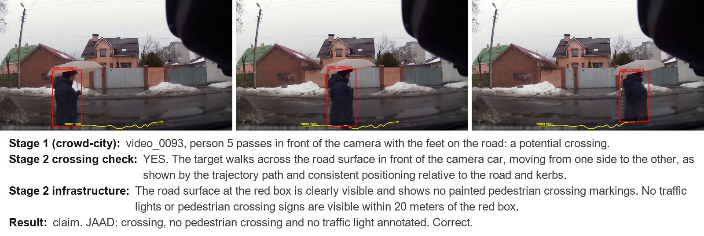

*Every image in this README is real pipeline output on JAAD. The red box is the tracked person, the yellow line the path of their feet.*

## Contents

* [How it works](#how-it-works)
* [What the VLM sees](#what-the-vlm-sees)
* [How it is evaluated](#how-it-is-evaluated)
* [Results](#results)
* [Keypoints of the people who crossed without a marking](#keypoints-of-the-people-who-crossed-without-a-marking)
* [Setup](#setup)
* [Running](#running)
* [Configuration reference](#configuration-reference)
* [Outputs](#outputs)
* [Earlier designs](#earlier-designs)
* [Repository structure](#repository-structure)

## How it works

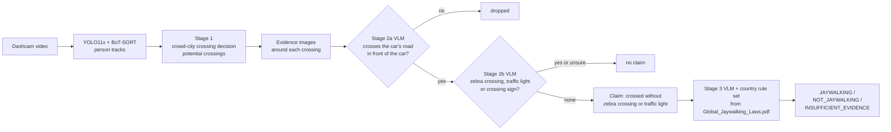

Each stage answers one question, and a claim needs every stage to agree. Any doubt means no claim.

1. **Stage 1: potential crossings, exactly crowd-city's crossing decision.** YOLO11x detects people and BoT-SORT (`configs/botsort.yaml`, identical to crowd-city's tracker) follows them. Then the decision of [crowd-city](https://github.com/crowd-dataset/crowd-city) (its default `crossing_rule: road_crossing`, copied at commit 340875e, with nothing added) proposes the people who walk across the road in front of the camera:
   * **Track joining:** a pedestrian walking sideways who is lost for up to 4 s behind a vehicle and returns under a new id gets one id again (`crowd_city_track_joining.py`).
   * **Box candidates:** the track passes in front of the camera (through the middle strip) or steps out there, moves sideways far enough, and changes size slowly. Riders and tracks that only move with the camera are dropped (`crowd_city_detection.py`).
   * **Feet on the road:** SegFormer reads the surface under the feet at sampled frames (1 Hz, 4 Hz where the track enters and leaves the road), and the person must walk at a plausible pace (`crowd_city_road_crossing.py`, applied to a clip by `crowd_city_road_rule.py`).
   * **The picture itself:** a person carried across the image by a turning camera, or a fast mover that cannot be verified, is dropped.

   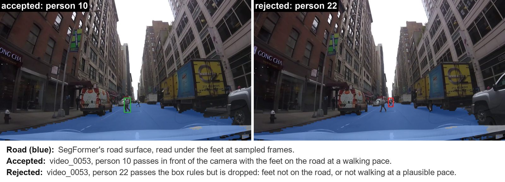

   Scored alone against JAAD's labels on 309 videos (no VLM; `scripts/crossing/evaluate_crowd_city_crossing.py`), it accepts 152 tracks, 147 of them a pedestrian JAAD marks as crossing: precision 96.7% (98.7% if the 3 unverifiable bystanders are left out). It finds 144 of the 462 JAAD crossers (recall 31.2%), and 25 of the 111 crossers with no zebra crossing and no traffic light.

   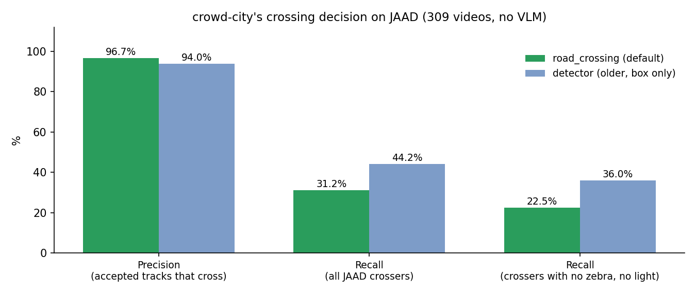

   crowd-city's older box-only detector (`crowd_city_crossing_rule: "detector"`, also with joining) accepts 217 tracks (precision 94.0%) and finds 204 of 462 (44.2%), 40 of the 111, so `road_crossing` trades recall for precision. 14 of the 23 correct claims in the results below are still proposed. Only these snippets go further: the VLM never sees the full footage.
2. **Stage 2: the VLM checks the snippet** (Qwen3-VL-8B-Instruct).
   * **Crossing check** (prompt `v3`): does the person walk across the road the camera car is driving on, in front of the car? Crossing a side street or another road is not of interest. Only a clear YES continues.
   * **Infrastructure check** (prompt `zebra_light_v5`): is there a zebra crossing, a traffic light, or a pedestrian crossing sign? This prompt never judges the person. A fixed policy then requires every infrastructure answer to be NO, for this person and for every other crossing person in the clip.
3. **Stage 3: the law.** Whether such a crossing is jaywalking depends on the country. A separate step (`scripts/law/run_jaywalking_law.py`) retrieves the rule set of the video's country from `Global_Jaywalking_Laws.pdf` (51 countries, plus a hand-written Bangladesh set), asks the VLM YES, NO, or UNKNOWN on each numbered condition (plus any hand-added `supplementary` condition of that country), and computes the label from the rule set's decision rule. The model never chooses the label.

After a run, an optional **approach review** (`scripts/review/run_approach_review.py`) looks at frames from a few seconds before each claimed crossing and flags a zebra crossing on the road ahead that the crossing window itself misses. It is a flag for a manual look, not a veto: nothing is dropped.

## What the VLM sees

For every accepted crossing, six moments are sampled from the crossing itself plus half a second either side. Each moment is turned into several views, so that small markings, signals, and signs are visible at near full resolution. Each VLM call sees four of the six moments.

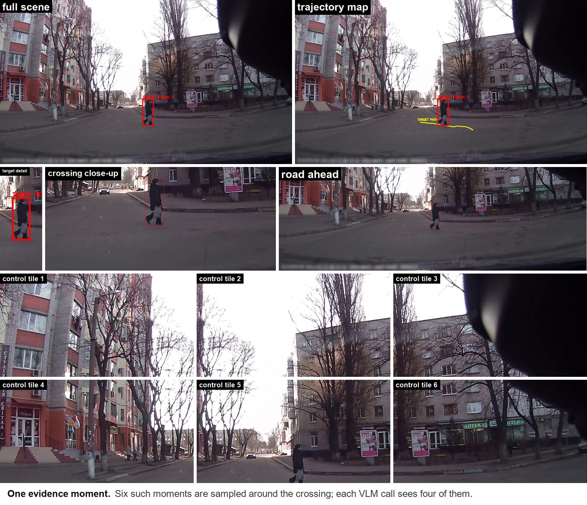

* **Full scene** and **trajectory map** (the path of the feet as a yellow line): used by the crossing check and stage 3.
* **Target detail**: a close-up of the person.
* **Crossing close-up** and **road ahead**: full resolution crops of the road around the feet, used for zebra crossings.
* **Control tiles**: six overlapping crops of the upper scene, used for traffic lights and crossing signs.

A person stage 1 proposed, but who only walks along the pavement, is dropped by the crossing check:

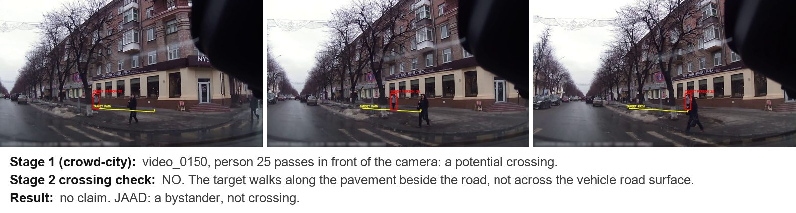

A real crossing at a zebra crossing is stopped by the infrastructure check:

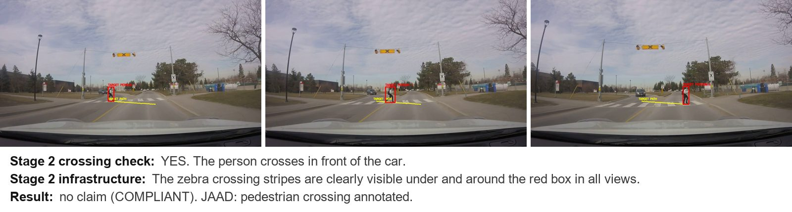

Stage 3 output for one claim (from `jaywalking_law/verdicts.jsonl`):

```json
{"video_id": "video_0084", "person_id": 2, "country": "CAN", "label": "JAYWALKING",
 "reason": "All required conditions met",
 "verdicts": {"CAN-R1": "YES", "CAN-R2": "YES", "CAN-R3": "YES"},
 "verdict_sources": {"CAN-R1": "vlm", "CAN-R2": "pipeline", "CAN-R3": "vlm"},
 "evidence_summary": "CAN-R1: The pedestrian is on a public road ... CAN-R3: The pedestrian crosses outside a designated crossing ...",
 "legal_basis": "Illegal (Provincial Highway Traffic Acts)"}
```

## How it is evaluated

The claim the method makes ("this person crossed without a zebra crossing and without a traffic light") must be true every time, so the evaluation measures **the precision of the claims** and how many real cases they find.

`scripts/jaad/run_jaad_person_audit.py` runs stages 1 and 2 over the saved tracks of a JAAD split and matches every claimed person to a JAAD pedestrian (box overlap of at least `jaad_match_iou` on at least `jaad_min_match_frames` frames). A claim is

* **confirmed** when that pedestrian has a JAAD crossing label and JAAD's per frame scene annotations mark no pedestrian crossing (`ped_crossing`) and no traffic light on its crossing frames,
* **wrong** when JAAD says the pedestrian is not crossing, or marks a pedestrian crossing or traffic light,
* **unverifiable** when the person is a JAAD bystander without behaviour labels, or no JAAD pedestrian. Unverifiable claims count as wrong, so the reported precision is a lower bound.

**Eligible crossers** are the JAAD pedestrians the method should find: crossing, with no pedestrian crossing and no traffic light on their crossing frames. Recall is confirmed claims over eligible crossers. The precision is reported with a one sided 95% Clopper-Pearson lower bound, because with few claims "100%" alone says little.

Claims that JAAD cannot settle were reviewed by hand and recorded in `data/claim_review.csv`.

## Results

The numbers below were measured with crowd-city's box-only detector (`crowd_city_crossing_rule: "detector"`, with track joining off). Stage 1 now defaults to crowd-city's `road_crossing` rule, whose crossing decision alone has precision 96.7% and recall 31.2% on JAAD (see Stage 1 under How it works); it proposes 14 of the 23 correct claims, and the full pipeline has not been rerun with it yet.

On all three JAAD splits (train, val, and test; 309 videos):

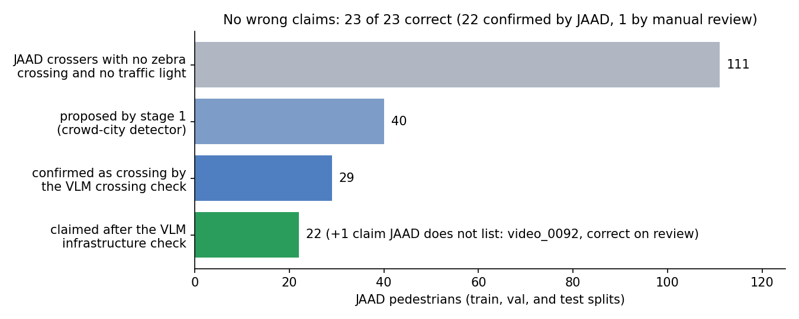

| JAAD split | Claims | Correct | Eligible crossers found |
| --- | ---: | ---: | ---: |
| Test (117 videos) | 8 | 8 | 7 of 39 |
| Train (165 videos) | 13 | 13 | 13 of 65 |
| Val (27 videos) | 2 | 2 | 2 of 7 |
| **All** | **23** | **23** (95% lower bound 87.8%) | **22 of 111 (20%)** |

* 22 claims are confirmed by JAAD. The 23rd (`video_0092`) JAAD marks as "traffic light in view", but the light is far from where the person crosses; manual review: correct.
* Most eligible crossers are lost in stage 1: the older box-only crowd-city detector proposed 40 of the 111 (the current `road_crossing` decision finds 25 of them, see Stage 1). The VLM crossing check then rejects some real crossers as "walking along the pavement".
* The crossing check prompt (`v3`) was chosen after the test split had been inspected, so the test split is no longer a clean held-out set.
* Stage 3 on the same 23 claims, applying three countries' rules: all `JAYWALKING` under Canada and Ukraine (crossing outside a designated crossing), all `NOT_JAYWALKING` under Australia (no crossing within 20 metres, so crossing there is lawful). JAAD has no per video country, so this checks that the rules are applied, not legal correctness.

### Crossings by country (CROWD samples, stages 1 and 2)

Daytime footage filmed from a car, run through stages 1 and 2 with the VLM at full 16-bit precision (`vlm_quantization: null`; segments from `scripts/crowd/select_country_sample.py`, seed 0). The six-country sample fills each country to about 100 hours from its capital first (`--capitals-first`: whole source videos in random order), and only when the capital has too few hours from the next biggest cities. South Korea, Vietnam, India, Brazil, Indonesia, Poland, South Africa, Thailand, Türkiye and the United States are a random sample of about 100 hours each. The country law (stage 3) is not used in these tables; its verdicts are [below](#stage-3-on-crowd-is-it-jaywalking-in-law). A crossing counts as
**without zebra crossing or traffic light** (jaywalking in the table) when stage 1 finds it and the VLM confirms it as a crossing and finds neither a zebra crossing, a traffic light
nor a crossing sign. 4,526 of the 4,684 planned segments finished (1,538 hours in 16 countries), processed on two machines and merged with each segment counted once.

| Country | Segments | Hours | Crossings detected (stage 1) | At a zebra crossing or light | Rejected by the VLM (not a crossing) | Jaywalking | Jaywalking per hour |
| --- | ---: | ---: | ---: | ---: | ---: | ---: | ---: |
| China | 221 | 96.4 | 2110 | 1903 | 188 | 19 | 0.20 |
| Japan | 205 | 100.6 | 3878 | 3626 | 239 | 13 | 0.13 |
| Bangladesh | 296 | 95.3 | 2199 | 99 | 1189 | **903** | **9.48** |
| France | 319 | 96.4 | 3551 | 3051 | 450 | 49 | 0.51 |
| Sweden | 370 | 99.1 | 2316 | 2003 | 234 | 67 | 0.68 |
| Denmark | 240 | 97.3 | 2854 | 2413 | 367 | 62 | 0.64 |
| South Korea | 185 | 100.1 | 1367 | 1205 | 138 | 23 | 0.23 |
| Vietnam | 329 | 99.9 | 913 | 236 | 564 | **111** | **1.11** |
| India | 469 | 99.8 | 994 | 221 | 519 | **248** | **2.48** |
| Brazil | 246 | 86.1 | 909 | 720 | 135 | 43 | 0.50 |
| Indonesia | 369 | 97.7 | 581 | 133 | 371 | 75 | 0.77 |
| Poland | 278 | 99.5 | 1537 | 1356 | 138 | 43 | 0.43 |
| South Africa | 387 | 96.7 | 822 | 496 | 230 | 95 | 0.98 |
| Thailand | 240 | 97.9 | 479 | 202 | 216 | 59 | 0.60 |
| Türkiye | 186 | 80.9 | 1038 | 646 | 250 | **135** | **1.67** |
| United States | 186 | 94.0 | 1445 | 1310 | 110 | 25 | 0.27 |

The table is also in [`docs/crossings_by_country.csv`](docs/crossings_by_country.csv). The tables in `docs` are made in two steps: `scripts/crowd/summarise_runs.py` summarises the finished runs on each machine where they are (counts per segment and movement aggregates; no boxes or video are copied), and `scripts/crowd/country_tables.py` merges those summaries, counting each segment once. The figures below are clickable: each opens an interactive version (hover for the values).

[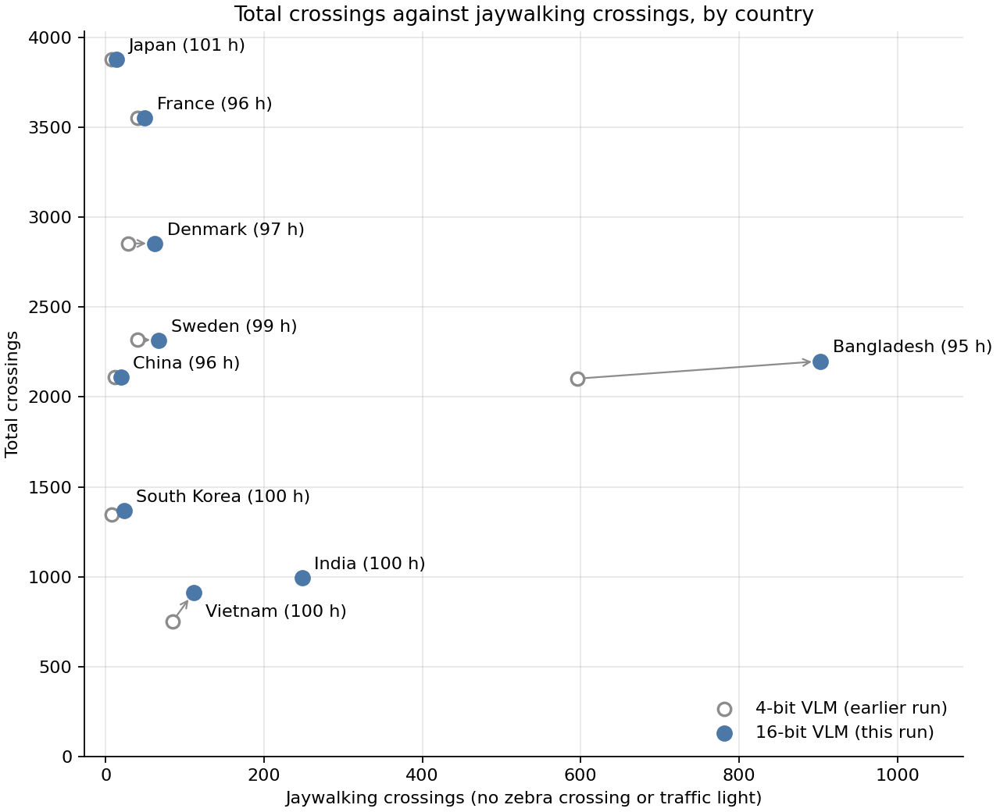](https://htmlpreview.github.io/?https://github.com/crowd-dataset/crowd-jaywalking/blob/main/docs/images/crossings_scatter.html)

The scatter plot (`scripts/crowd/plot_crossing_scatter.py`) puts the jaywalking crossings on the X axis and all crossings detected on the Y axis, one point per country. Filled points are this 16-bit run; open grey points are the earlier run with the VLM in 4-bit mode, with an arrow from each to the same country's 16-bit point (India and the seven countries added last were only run at 16 bits). Labels that would overlap a point or another label are moved away and joined to their point by a thin line. The same plot per hour of footage:

[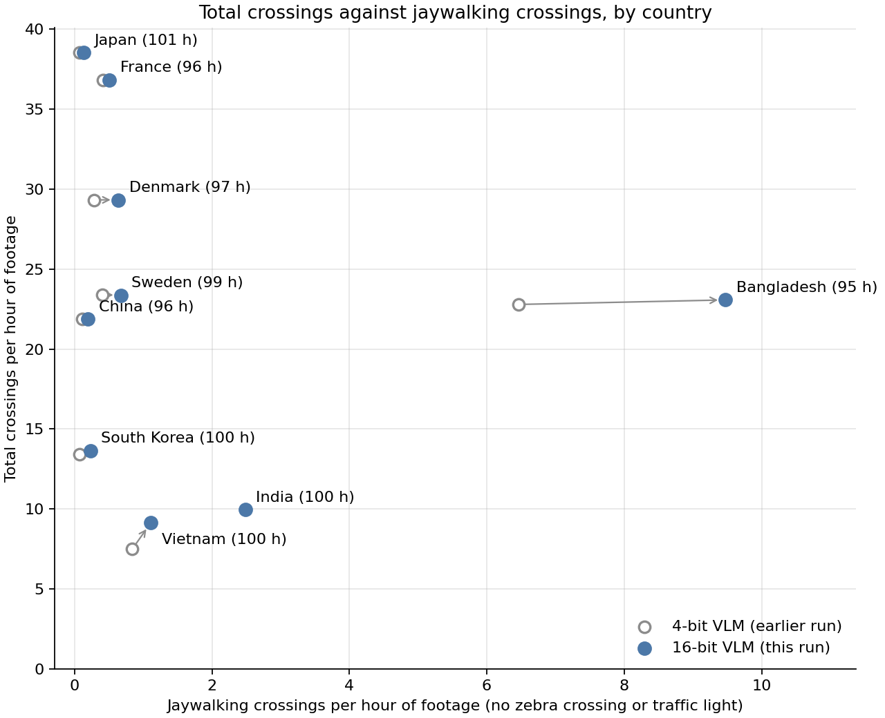](https://htmlpreview.github.io/?https://github.com/crowd-dataset/crowd-jaywalking/blob/main/docs/images/crossings_scatter_per_hour.html)

Per country, the crossings detected, those at a zebra crossing or light, and the jaywalking ones (`scripts/crowd/plot_country_crossings.py`):

[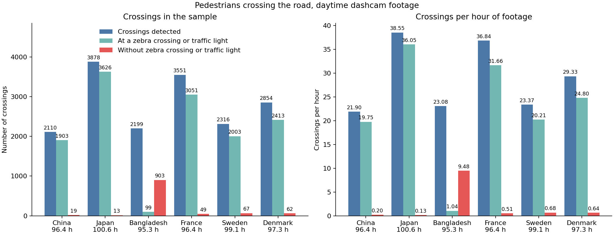](https://htmlpreview.github.io/?https://github.com/crowd-dataset/crowd-jaywalking/blob/main/docs/images/six_countries_crossings.html)

[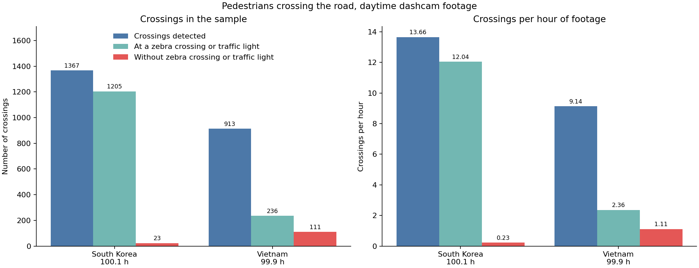](https://htmlpreview.github.io/?https://github.com/crowd-dataset/crowd-jaywalking/blob/main/docs/images/korea_vietnam_crossings.html)

[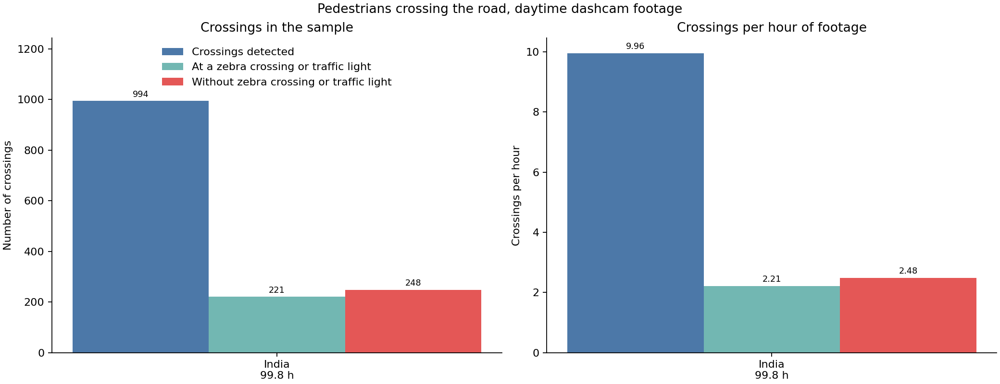](https://htmlpreview.github.io/?https://github.com/crowd-dataset/crowd-jaywalking/blob/main/docs/images/india_crossings.html)

[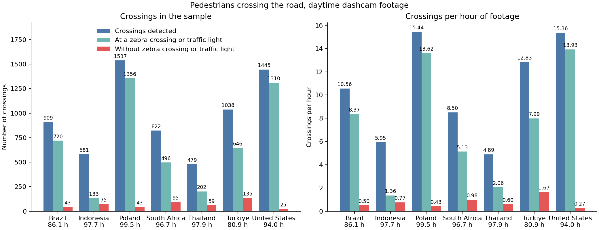](https://htmlpreview.github.io/?https://github.com/crowd-dataset/crowd-jaywalking/blob/main/docs/images/seven_countries_crossings.html)

* The three right-hand counts add up to the detected crossings, except for 65 crossings the VLM left `UNCERTAIN` (Sweden 12, Denmark 12, Brazil 11, Bangladesh 8, Türkiye 7, India 6, Vietnam 2, Indonesia 2, Thailand 2, France 1, South Korea 1, South Africa 1). "Rejected by the VLM" means stage 1 flagged the person but the VLM crossing check answered NO to "is this person walking across the road?" (typically a person on the pavement, walking along the road or riding a bike or motorbike), so the person is not counted as a crossing and is never judged for a zebra crossing or light, and counts in neither of the other two columns. The jaywalking column is therefore a lower bound if the VLM wrongly rejected real crossings, and "Crossings detected" is an upper bound on the real crossings (detected minus rejected); Indonesia (371 of 581), Vietnam (564 of 913), Bangladesh (1189 of 2199), India (519 of 994) and Thailand (216 of 479) have the most.
* Bangladesh stands out with 9.5 jaywalking crossings per hour of footage, then India with 2.5, Türkiye with 1.7, Vietnam with 1.1 and South Africa with 1.0; the other eleven countries have 0.8 or fewer. Japan has the most crossings of all (3878) and France the next most (3551), almost all at a zebra crossing or a traffic light. Bangladesh has only about 96 hours of daytime car footage in the mapping and only 12.6 of them are Dhaka (Sylhet has 69), so its rate describes Sylhet more than the capital.
* 158 of the 4,684 segments failed after retries: 116 without a precomputed track file, 33 whose video could not be opened, 6 where the file server kept failing and 3 whose video is not on the file server. That is why most countries are a few hours under 100, and Brazil (41 failed, 86.1 h) and Türkiye (41 failed, 80.9 h) clearly so: most of their failed segments have no CROWD track file (the failed segments are listed in each run's `errors.csv`).
* The hours of the finished segments are Tokyo 100.6; Paris 96.4; Copenhagen 97.3; Stockholm 97.5 and Gothenburg 1.6; Beijing 44.2, Shanghai 33.2 and Shenzhen 18.9; Sylhet 69.1, Dhaka 12.6 and 22 other Bangladeshi towns; Seoul 40.1, Busan 29.2 and 33 other South Korean cities; Hanoi 80.9 and 14 other Vietnamese places; Mumbai 21.0, New Delhi 13.4, Kolkata 13.1 and 96 other Indian places; São Paulo 36.1, Rio de Janeiro 24.0 and 48 other Brazilian places; Jakarta 46.1, Yogyakarta 16.2 and 62 other Indonesian places; Warsaw 52.3 and 95 other Polish places; Cape Town 62.9, Johannesburg 13.6 and 47 other South African places; Bangkok 78.2 and 24 other Thai places; Istanbul 48.3, Ankara 7.5 and 46 other Turkish places; Chicago 22.0, New York 20.1 and 75 other US places. The counts are not checked by hand; `scripts/crowd/make_verification_clips.py` cuts a random sample of clips, with the person's box drawn, to check them by eye.
* **4-bit against 16-bit.** The earlier run ([`docs/crossings_by_country_4bit.csv`](docs/crossings_by_country_4bit.csv)) used the VLM in 4-bit mode on almost the same segments (India and the seven countries added last were only run at 16 bits, so they are not in this comparison). The 16-bit VLM rejects fewer of the people stage 1 flags (3,369 against 3,907) and labels more crossings as jaywalking in every country (1,247 against 813; Bangladesh 903 against 596). Bangladesh and Vietnam have the highest rates in both, and the per-hour order of the other six changes a little. The 4-bit South Korea and Vietnam run was made earlier, and stage 1 found somewhat fewer crossings in it (Vietnam 749 against 913), so for those two countries the points also move up. Per country, 4-bit / 16-bit:

| Country | Segments, 4-bit / 16-bit | Crossings detected | Jaywalking | Jaywalking per hour | Rejected by the VLM |
| --- | ---: | ---: | ---: | ---: | ---: |
| China | 221 / 221 | 2,110 / 2,110 | 11 / 19 | 0.11 / 0.20 | 11.1% / 8.9% |
| Japan | 205 / 205 | 3,878 / 3,878 | 7 / 13 | 0.07 / 0.13 | 6.9% / 6.2% |
| Bangladesh | 287 / 296 | 2,102 / 2,199 | 596 / 903 | 6.46 / 9.48 | 66.6% / 54.1% |
| France | 319 / 319 | 3,551 / 3,551 | 40 / 49 | 0.42 / 0.51 | 16.7% / 12.7% |
| Sweden | 370 / 370 | 2,318 / 2,316 | 40 / 67 | 0.40 / 0.68 | 14.5% / 10.1% |
| Denmark | 240 / 240 | 2,854 / 2,854 | 28 / 62 | 0.29 / 0.64 | 16.5% / 12.9% |
| South Korea | 185 / 185 | 1,344 / 1,367 | 7 / 23 | 0.07 / 0.23 | 10.8% / 10.1% |
| Vietnam | 330 / 329 | 749 / 913 | 84 / 111 | 0.84 / 1.11 | 61.9% / 61.8% |
| **All** | 2,157 / 2,165 | 18,906 / 19,188 | 813 / 1,247 | 1.04 / 1.59 | 20.7% / 17.6% |

* "Korea" is South Korea; North Korea has only 2.4 hours of footage in the mapping.

### Jaywalking rates with 95% intervals

The rate of crossings without a marking per hour of footage, with a 95% interval from a bootstrap over segments (4,000 resamples), and what the crossings stage 1 detected turned out to be. The numbers, with the intervals and the share of judged crossings without a marking (Wilson interval), are in [`docs/jaywalking_rates.csv`](docs/jaywalking_rates.csv).

[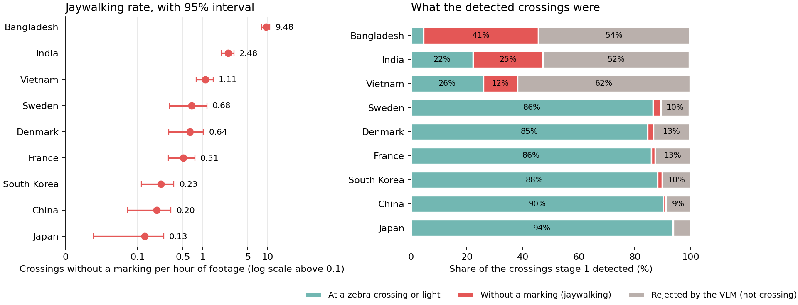](https://htmlpreview.github.io/?https://github.com/crowd-dataset/crowd-jaywalking/blob/main/docs/images/jaywalking_rate.html)

| Country | Jaywalking per hour (95% interval) | Share of judged crossings without a marking (95% interval) | Rejected by the VLM |
| --- | ---: | ---: | ---: |
| Bangladesh | **9.48** (8.05–10.89) | **90.1%** (88.1–91.8) | 54.1% |
| India | **2.48** (1.97–3.04) | **52.9%** (48.4–57.4) | 52.2% |
| Türkiye | **1.67** (1.13–2.28) | **17.3%** (14.8–20.1) | 24.1% |
| Vietnam | **1.11** (0.80–1.45) | **32.0%** (27.3–37.1) | 61.8% |
| South Africa | 0.98 (0.62–1.44) | **16.1%** (13.3–19.3) | 28.0% |
| Indonesia | 0.77 (0.49–1.10) | **36.1%** (29.8–42.8) | 63.9% |
| Sweden | 0.68 (0.31–1.16) | 3.2% (2.6–4.1) | 10.1% |
| Denmark | 0.64 (0.30–1.03) | 2.5% (2.0–3.2) | 12.9% |
| Thailand | 0.60 (0.32–1.00) | **22.6%** (18.0–28.1) | 45.1% |
| France | 0.51 (0.30–0.76) | 1.6% (1.2–2.1) | 12.7% |
| Brazil | 0.50 (0.32–0.71) | 5.6% (4.2–7.5) | 14.9% |
| Poland | 0.43 (0.14–0.92) | 3.1% (2.3–4.1) | 9.0% |
| United States | 0.27 (0.14–0.42) | 1.9% (1.3–2.8) | 7.6% |
| South Korea | 0.23 (0.11–0.36) | 1.9% (1.3–2.8) | 10.1% |
| China | 0.20 (0.09–0.33) | 1.0% (0.6–1.5) | 8.9% |
| Japan | 0.13 (0.04–0.25) | 0.4% (0.2–0.6) | 6.2% |
| **All** | 1.28 | 9.1% | 19.8% |

* Three groups by the share of judged crossings without a marking: Bangladesh (90%) and India (53%); Indonesia, Vietnam, Thailand, Türkiye and South Africa (16–36%); and the other nine countries (at most about 6%: Brazil 5.6%, all others 3.2% or less). The share intervals of the middle group are apart from those of the low group. By the rate per hour, Bangladesh (about 9.5) is apart from all others and India (about 2.5) from all but Türkiye (1.7); Vietnam (1.1) comes next, and from South Africa down (1.0 and less) the intervals overlap, so that order is not settled by this sample.
* The rate per hour mixes how many people cross with how many of them use a marking; the share separates the two. Japan has the most crossings of all (38.6 detected per hour) and the lowest share without a marking (0.4%). Indonesia and Thailand have few crossings (5–6 per hour) but a large share of them without a marking (36% and 23%), so their rates per hour are moderate.
* Indonesia, Vietnam, Bangladesh, India and Thailand also have by far the most people rejected by the VLM as not crossing (45–64%, against 8–28% elsewhere): many people walk on the carriageway itself and motorcycles are common there, so more such people pass stage 1.

### Unmarked crossings and missing crossing infrastructure

Where scenes have no crossing infrastructure, more people cross without a marking. A street scene (segment) counts as *without crossing infrastructure* when someone crossed in it, the marking check judged the crossing, and no crossing in it was at a zebra crossing, traffic light or crossing sign. The counts per country are in [`docs/infrastructure_by_country.csv`](docs/infrastructure_by_country.csv), and the figures are drawn by `scripts/crowd/plot_infrastructure_scatter.py`.

[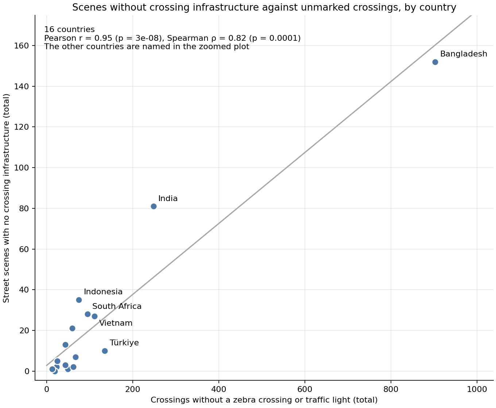](https://htmlpreview.github.io/?https://github.com/crowd-dataset/crowd-jaywalking/blob/main/docs/images/infrastructure_scatter.html)

[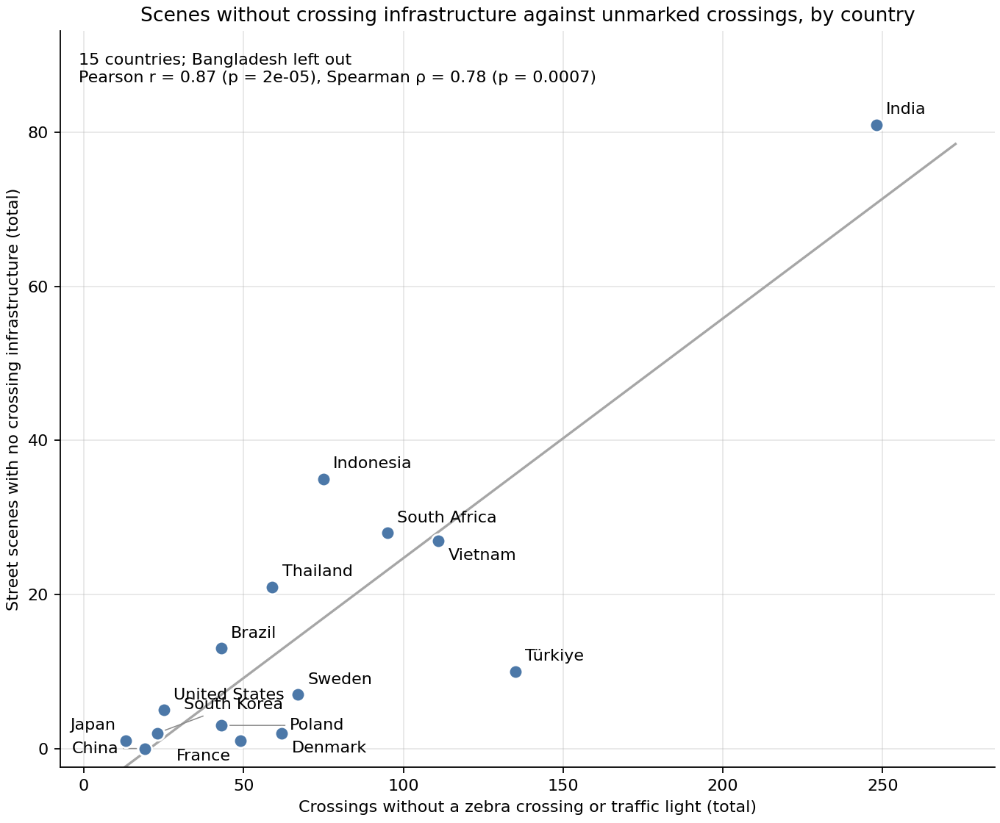](https://htmlpreview.github.io/?https://github.com/crowd-dataset/crowd-jaywalking/blob/main/docs/images/infrastructure_scatter_zoom.html)

* Over the 16 countries, Pearson r = 0.95 and Spearman ρ = 0.82; without Bangladesh, r = 0.87 and ρ = 0.78. So the relation does not rest on Bangladesh alone.
* Indonesia, Thailand and South Africa sit with Vietnam: few unmarked crossings in total, but many scenes without crossing infrastructure. Türkiye is the exception: many unmarked crossings (135), but only 10 scenes without infrastructure.
* Both counts come from the same marking check, and scenes are counted only where someone crossed, so part of the relation is built in. An audit of the same streets that does not depend on anyone crossing would separate them.

### How people move when they cross without a marking

For each person who crossed, with or without a marking, the movement is measured from the boxes of their track. The camera moves and people are at different distances, so movement is measured in the image, in the person's own body height (the median height of their box) per second:

* **Sideways speed**: the person's median sideways speed over the track (the figure shows the mean over people).
* **Stopped mid-crossing**: stood still (below 0.15 body heights per second) for at least 0.5 s after starting to walk and before walking on.
* **Crossed with others**: another person's crossing in the same segment overlapped theirs within 1 s.
* **Vehicles in view**: the mean number of cars, buses, trucks and motorcycles in the CROWD tracks from 1 s before to 1 s after the crossing.

Because these are measured in the image of a moving camera, the two groups are compared only **within** a country, where the footage is alike, and only where there are at least 20 crossings without a marking (China, 19, and Japan, 13, are left out). Movement could be measured for 1,891 crossings without a marking and 18,488 at one. The values with 95% intervals are in [`docs/crossing_movement.csv`](docs/crossing_movement.csv).

[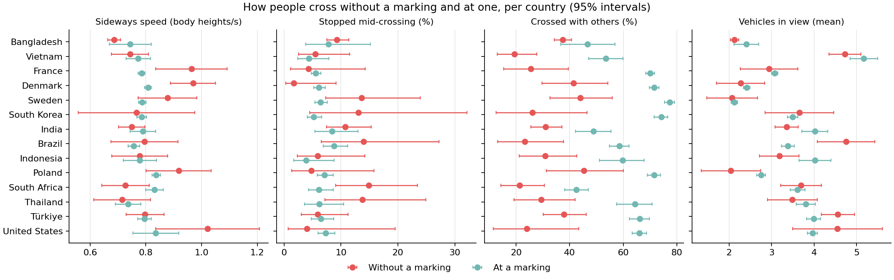](https://htmlpreview.github.io/?https://github.com/crowd-dataset/crowd-jaywalking/blob/main/docs/images/crossing_movement.html)

| Country | People without / at a marking | Crossed with others (%), without / at | Vehicles in view, without / at | Sideways speed (body heights/s), without / at |
| --- | ---: | ---: | ---: | ---: |
| Bangladesh | 852 / 90 | 37 / 47 | 2.1 / 2.4 | 0.69 / 0.74 |
| Vietnam | 109 / 228 | 19 / 54 | 4.7 / 5.2 | 0.74 / 0.77 |
| France | 47 / 2,882 | 26 / 70 | 2.9 / 3.1 | 0.96 / 0.79 |
| Denmark | 58 / 2,276 | 41 / 72 | 2.3 / 2.4 | 0.97 / 0.81 |
| Sweden | 66 / 1,900 | 44 / 77 | 2.1 / 2.1 | 0.88 / 0.79 |
| South Korea | 23 / 1,158 | 26 / 74 | 3.7 / 3.5 | 0.77 / 0.79 |
| India | 242 / 213 | 31 / 49 | 3.4 / 4.0 | 0.75 / 0.79 |
| Brazil | 43 / 682 | 23 / 58 | 4.8 / 3.4 | 0.80 / 0.76 |
| Indonesia | 68 / 129 | 31 / 60 | 3.2 / 4.0 | 0.78 / 0.78 |
| Poland | 42 / 1,298 | 45 / 71 | 2.0 / 2.8 | 0.92 / 0.84 |
| South Africa | 94 / 476 | 21 / 42 | 3.7 / 3.6 | 0.73 / 0.83 |
| Thailand | 58 / 194 | 29 / 64 | 3.5 / 3.8 | 0.71 / 0.74 |
| Türkiye | 135 / 615 | 38 / 66 | 4.6 / 4.0 | 0.80 / 0.80 |
| United States | 25 / 1,241 | 24 / 66 | 4.6 / 4.0 | 1.02 / 0.84 |

* **People who cross without a marking cross alone more often.** This holds in all fourteen countries compared, and in thirteen of them the intervals are apart (in Bangladesh they overlap). Over all sixteen countries, 34.0% of crossings without a marking overlapped with another person's crossing, against 71.3% at a marking. It is the clearest difference.
* **Vehicles around them have no common direction.** In nine of the fourteen countries fewer vehicles were in view of people crossing without a marking (in India the intervals are apart, 3.4 against 4.0), but in Brazil (4.8 against 3.4) and Türkiye (4.6 against 4.0) there were clearly more (intervals apart), and in the others the intervals overlap; over all sixteen, 2.9 against 3.0. Earlier, with nine countries, this looked like waiting for a gap in traffic; with sixteen it does not hold as a general pattern.
* **Sideways speed has no common direction.** In France and Denmark people crossing without a marking moved faster sideways than at a marking (intervals apart); in Sweden, Poland and the United States the difference points the same way but the intervals overlap; in the other countries the two groups are about the same (in South Africa slower without a marking, with overlapping intervals).
* **Stopping mid-crossing was rare in both groups** (9.1% without a marking, 5.6% at one, over all sixteen countries), with wide intervals where crossings without a marking are few; only in South Africa are the intervals apart (14.9% against 6.1%). Turning back was rare too (6.0% and 7.0%).

### Stage 3 on CROWD: is it jaywalking in law?

Stage 3 (`scripts/law/run_jaywalking_law.py`, Qwen3.5-27B at 4-bit) judged the crossings without a marking of eleven of the sixteen countries against the country's rule set. The evidence images of the runs that kept none were drawn again with `scripts/law/rebuild_evidence.py --fetch`, which cuts each claim clip again from its CROWD video and deletes it afterwards. Where a condition is judged on the approach (Bangladesh's `BGD-R3`), it also saves the approach views to `jaywalking_law/approach_frames`, which stage 3 then uses without the clip. Bangladesh, China, Japan, France and Denmark, part of India and the last few segments of Sweden and Vietnam are not judged yet.

| Country | Without a marking | Judged | `JAYWALKING` | `NOT_JAYWALKING` | `INSUFFICIENT_EVIDENCE` | What decides it |
| --- | ---: | ---: | ---: | ---: | ---: | --- |
| Türkiye | 135 | 135 | 135 | 0 | 0 | Crossing anywhere other than a marked crossing is an offence |
| Indonesia | 75 | 75 | 74 | 0 | 1 | Crossing outside a designated crossing facility |
| Thailand | 59 | 59 | 55 | 0 | 4 | Crossing outside a designated crossing area |
| Poland | 43 | 43 | 4 | 0 | 39 | Only where a crossing is available (as South Africa), or using a phone while crossing (the 4) |
| South Korea | 23 | 23 | 20 | 0 | 3 | Crossing outside a crosswalk |
| Brazil | 43 | 43 | 0 | 25 | 18 | An offence only where traffic is controlled or a footbridge is not used |
| United States | 25 | 25 | 2 | 15 | 8 | By state: New York City decriminalised, California needs a hazard, most other states undecided |
| Sweden | 67 | 60 | 0 | 60 | 0 | No offence |
| South Africa | 95 | 95 | 0 | 1 | 94 | Only where a crossing is available, with no distance: undecided from a dashcam view |
| Vietnam | 111 | 104 | 0 | 0 | 104 | The same as South Africa |
| India | 248 | 136 | 0 | 0 | 136 | The rule set names no conditions |

* **The verdict follows the wording of the law more than the scene.** Where the law forbids crossing outside a marked crossing (Türkiye, Indonesia, Thailand, South Korea), nearly every crossing without a marking is `JAYWALKING`. Where it applies only where a crossing is available and sets no distance (South Africa, Vietnam), a short dashcam view cannot settle it, and nearly all are `INSUFFICIENT_EVIDENCE`. Brazil forbids it only where traffic is controlled or a footbridge is there, which a crossing away from any marking rarely is.
* **Poland: a condition that asks two things.** `POL-T1` ("a crossing is available and the pedestrian does not use it") was answered YES in all 43 claims at first, in 35 of them while the VLM wrote that no crossing was present, so all 43 came out `JAYWALKING`. The hand-added condition `POL-X1` now asks only whether a crossing is visible near the crossing place; when it is not (NO or UNKNOWN), `POL-T1` counts as UNKNOWN, as for South Africa and Vietnam. It was NO for all 43; the 4 still `JAYWALKING` are people using a phone while crossing (`POL-T3`).
* Per run, the verdicts are in `results/<run>/jaywalking_law/verdicts.jsonl` on the machine that ran it.

### Why the VLM runs at 16-bit precision

The first runs used the VLM in 4-bit mode to save memory. To check the crossing check, 121 people that stage 1 had proposed in those runs, across all eight countries and including crossings the VLM had kept and ones it had rejected, were reviewed by hand from a clip with the person's box drawn: crossing the camera car's road at a marking, crossing it without one, or not crossing it. The crossing check was then asked again for the same people with the VLM at 16-bit precision. 11 of the 16-bit answers stopped with an error, which leaves 110 people: 63 who crossed and 47 who did not.

| Setting | Agrees with the reviewer | Real crossings found | People who did not cross but were accepted |
| --- | ---: | ---: | ---: |
| 4-bit, window around the crossing | 68 of 110 | 21 of 63 (33%) | 0 of 47 |
| **16-bit, window around the crossing** | **81 of 110** | **42 of 63 (67%)** | 8 of 47 |
| 16-bit, whole track | 76 of 110 | 41 of 63 (65%) | 12 of 47 |

The 4-bit VLM rejected two thirds of the real crossings; at 16-bit it finds twice as many and accepts a few people who did not cross. Showing it the whole track instead of the window around the crossing did not help. The results above therefore use the 16-bit VLM with the crossing window. The counts remain lower bounds: stage 1 finds about a third of the crossings on JAAD, and the crossing check finds about two thirds of the real crossings in this sample.

## Keypoints of the people who crossed without a marking

After stages 1 and 2, `scripts/crowd/run_keypoints.py` measures how the people labelled `JAYWALKING` (crossed with no zebra crossing, traffic light or crossing sign in view) move their head and body. For each person it reads their boxes from the CROWD track file, opens the source video (from `--video-dir` if it is there, else downloaded from the CROWD file server and deleted afterwards), crops every frame of the track around the box with a 35% margin (scaled up to at least 256 pixels high), runs a YOLO11 pose model (`yolo11x-pose.pt`) on the crops, and keeps the pose whose box overlaps the tracked box most (IoU of at least 0.3). `--labels JAYWALKING COMPLIANT` adds the people who crossed at a marking, for a comparison in the same footage.

```
uv run python scripts/crowd/run_keypoints.py results/six_countries_100h_16bit results/korea_vietnam_16bit --output results/keypoints_16bit
```

| Output | Contents |
| --- | --- |
| `keypoints/<video_key>_person<id>.csv` | One row per frame of the track: time, tracked box, the 17 COCO keypoints (x, y in pixels of the full frame, confidence), and the per-frame measures below |
| `people.csv` | One row per person: run, country, label, frames with a pose, and the per-person measures |
| `errors.csv` | People that could not be done, with the reason |

A person whose keypoint CSV exists is skipped on a rerun. The measures (a keypoint counts at confidence 0.5 or more):

* **face_to_camera**: nose and both eyes visible. The camera is in the car that approaches the person, so the person looks towards the car.
* **side_on**: the shoulder span is less than 0.45 of the torso length, so the body faces across the road.
* **glance**: face_to_camera while side_on: the head is turned to the car while the body crosses.
* **head_yaw**: the nose minus the middle of the ears (or the eyes), over the shoulder span.
* Per person: the share of posed frames with each of these, the number of separate glances (at least 0.2 s), whether the person glanced at the car before stepping onto the road, and how many seconds before.

Settings: `--pose-model`, `--device`, `--batch`, `--stride` (every n-th frame), `--min-iou`, `--min-keypoint-conf`, `--min-glance-seconds`, `--countries`, `--max-people`, `--keep-videos`. The measures are read in the image of a moving camera, and small, distant people give less reliable keypoints; check `pose_share` and the keypoint confidences before comparing groups.

## Setup

All commands run from the repository root (PowerShell on Windows; the same commands work in a Linux shell with `/` paths).

### 1. Install

```powershell
uv sync
uv run python -c "import torch; print(torch.__version__, torch.cuda.is_available())"
```

`pyproject.toml` installs PyTorch from the CUDA 12.8 wheel index (needed for RTX 50 series GPUs). A CPU build works but the VLM is about 25 times slower. Model weights (YOLO11x, Qwen3-VL-8B, about 17 GB) download on first use; set `HF_HOME` or `vlm_cache_dir` to keep the Hugging Face cache on another drive.

### 2. Configuration and secrets

The project follows the CROWD repositories' convention: `default.config` is the committed template of the user settings (paths, which split or video to run, models and GPU memory, the CROWD file server, logging), and `config` is your local copy (ignored by Git). Settings are read with `common.get_configs`, credentials with `common.get_secrets`, and logging goes through `custom_logger.CustomLogger` at `logger_level`. The method's own values (thresholds, prompts, policy, evidence views) are fixed in `scripts/core/method.py`, not in `default.config`.

```powershell
Copy-Item .\default.config .\config
Copy-Item .\default.secret .\secret      # only for downloading CROWD videos
```

Edit `config` for paths and runs. When `default.config` gains settings, add them to `config` too: a `config` that lacks an entry of `default.config` stops the run. To try a different method value, add that setting to `config` (the method's values are in `scripts/core/method.py`); the run logs every such override. `secret` holds `ftp_username`, `ftp_password`, and optionally `ftp_token` for the CROWD file server. Every setting of `default.config` is described in the [configuration reference](#configuration-reference).

### 3. Data

* **JAAD**: `.\scripts\jaad\download_jaad.ps1` downloads the JAAD 2.0 annotations and all 346 clips into `data/JAAD`.
* **CROWD**: `mapping.csv` lists every CROWD source video, its segments, city, state, and country. Videos are taken from the `videos` folders or downloaded from the file server into `crowd_download_dir`.
* **CROWD footage**: only segments filmed from a car are processed (`crowd_vehicle_types`, default `[0]`). That is 83,549 of the 90,078 mapped segments, and in the Netherlands 962 of 1,682 (227 of 548 hours), because 40% of the Dutch footage is filmed from a bicycle.
* **CROWD tracks**: by default (`crowd_tracks_source` `"precomputed"`) the run uses the YOLO11x + BoT-SORT tracks CROWD has already computed, one `<video_id>_<start_second>_<fps>.csv` per segment in its `bbox` folder (`/media/salam/crowd-tue-3/pedestrians_in-youtube/data/bbox`). They are read from `crowd_bbox_dirs` when that folder is mounted, otherwise downloaded from the same file server as the videos (`crowd_bbox_ftp_folder` below each of `crowd_bbox_ftp_aliases`) into `crowd_bbox_download_dir`. A segment without a track file is recorded in `errors.csv` (stage `tracks`), not tracked again. The videos are still needed for the evidence images.
* **Jaywalking laws**: `data/Global_Jaywalking_Laws.pdf`, converted into `configs/jaywalking_rules.json` (committed).

## Running

| Step | Command | Notes |
| --- | --- | --- |
| Unit tests | `uv run python -m unittest discover -s tests` | No GPU or model weights needed |
| Track JAAD | `uv run python -u .\scripts\jaad\run_jaad_crossing_benchmark.py` | Once per `jaad_benchmark_split` (`train`, `val`, `test`); saves tracks to `jaad_benchmark_results` |
| Stages 1 and 2 on JAAD, with the audit | `uv run python -u .\scripts\jaad\run_jaad_person_audit.py` | Split from `jaad_audit_split`; resumes after an interruption |
| Stages 1 and 2 on CROWD | `uv run python -u .\scripts\crowd\run_crowd_analysis.py` | `crowd_max_segments` or `crowd_video_id` limit the run |
| Sample of CROWD segments | `uv run python scripts/crowd/select_country_sample.py results/selection.csv --countries China Japan --hours 100` | Random daytime car segments, hours split equally over the countries; point `crowd_selection` at the CSV |
| Crossings per country | `uv run python scripts/crowd/plot_country_crossings.py <results folder>` | Writes `crossings_by_country.png` and `.csv` into the results folder; `--table <csv> --output <png>` plots a country table instead, `--countries` picks and orders the countries, `--html` also writes an interactive `.html` (needs `uv run --with plotly`) |
| Total against jaywalking crossings | `uv run python scripts/crowd/plot_crossing_scatter.py <results folder> [<results folder> ...]` | Scatter plot, one point per country, over one or more runs; `--per-hour` divides both axes by the hours of footage; `--output` sets the file; `--table <csv>` plots a country table instead, `--compare <csv>` adds a second table (such as the 4-bit run) as open circles with arrows, `--html` also writes an interactive `.html` (needs `uv run --with plotly`) |
| Summarise finished runs | `python3 -I scripts/crowd/summarise_runs.py summary.json --root results --run <run>=<selection.csv> [--run ...]` | Run where the results are; reads only and needs only the standard library. Per-segment counts, the segments each run planned and finished, and the movement of the people who crossed, as one small JSON per machine |
| Country tables | `uv run python scripts/crowd/country_tables.py summary_*.json --output-dir docs` | Merges the summaries (each segment once) into `crossings_by_country.csv`, `jaywalking_rates.csv`, `crossing_movement.csv` and `infrastructure_by_country.csv` |
| Infrastructure figures | `uv run --with plotly python scripts/crowd/plot_infrastructure_scatter.py docs/infrastructure_by_country.csv --output docs/images/infrastructure_scatter.png --html` | Scenes without crossing infrastructure against unmarked crossings, one point per country; `--exclude Bangladesh` for the zoomed plot, `--label-only` names only the given countries |
| Jaywalking rates and movement figures | `uv run --with plotly python scripts/crowd/plot_country_analysis.py docs/jaywalking_rates.csv docs/crossing_movement.csv --output-dir docs/images --html` | The rate per country with 95% intervals and what the detected crossings were (`jaywalking_rate`), and the movement of people crossing without a marking and at one (`crossing_movement`); `--html` also writes interactive versions |
| Keypoints of the people who crossed without a marking | `uv run python scripts/crowd/run_keypoints.py <results folder> [...] --output <folder>` | YOLO11 pose on crops around each `JAYWALKING` person's track; keypoints per frame and head and body measures per person (see [Keypoints](#keypoints-of-the-people-who-crossed-without-a-marking)) |
| Clips to check by eye | `uv run python scripts/crowd/make_verification_clips.py <results folder>` | A random sample per country of crossings without zebra crossing or light, at one, and not confirmed, as clips with the person's box; `index.csv` links each to YouTube |
| Share the surface labels | `uv run python scripts/crowd/sync_segmentation.py pull` or `push` | Merges `crowd_city_segmentation_store` with crowd-city's store folder on the CROWD server's disk (`pedestrians_in-youtube/seg`, crowd-city's `seg_data`), so a segment either project has segmented is not segmented again by the other. Tracks one side lacks are added to both; nothing is overwritten or deleted. Password in `secret` as `crowd_tue3_ssh_password` |
| Stage 1 alone against JAAD | `uv run python -u .\scripts\crossing\evaluate_crowd_city_crossing.py` | No VLM. Writes `<results>/crowd_city_stage1/summary.json` (precision and recall of crowd-city's decision on all three splits) |
| Stage 3 (law) | `uv run python .\scripts\law\run_jaywalking_law.py <results folder>` | CROWD takes the country from `mapping.csv`; for JAAD add `--country CAN` (repeatable) |
| Approach review | `uv run python .\scripts\review\run_approach_review.py <results folder>` | After a run, before or after stage 3: flags claims with a zebra crossing on the road ahead in the seconds before the crossing, for a manual look. Changes nothing; see [Outputs](#outputs) |
| One video | `uv run python .\scripts\evaluation\run_one_video.py` | Set `smoke_test_video` first |
| Rebuild the law rules | `uv run python .\scripts\law\build_jaywalking_rules.py data\Global_Jaywalking_Laws.pdf configs\jaywalking_rules.json` | After an updated PDF; then rerun stage 3 only. Needs `pdftotext` (poppler) |
| README figures | `uv run python .\scripts\docs\make_readme_figures.py` | From the evidence of the configured `results` run |

Stage 3 runs separately from stages 1 and 2, so it can use a different model (`jaywalking_law_model`) without sharing GPU memory, and it can be rerun when the law rules change without rerunning the rest. The United States conditions come from the location: Texas and Florida enforce, New York City is decriminalised, California needs an immediate collision hazard (`USA-R4`), and any other state stays UNKNOWN, as the rule set requires. Ireland, New Zealand, Sweden, and the United Kingdom have no offense; Greece, India, Mexico, Nigeria, Pakistan, and Zimbabwe have no specified conditions; countries without a rule set are recorded as `NO_RULE_SET`. The rule sets cover 51 of the 238 CROWD countries and 87.6% of its hours.

Tools from the earlier designs are still available: `scripts/crossing/train_jaad_crossing_classifier.py`, `scripts/crossing/evaluate_jaad_crossing_classifier.py`, `scripts/crossing/train_crossing_gate.py`, `scripts/jaad/compute_jaad_camera_motion.py`, `scripts/evaluation/prepare_splits.py`, `scripts/evaluation/run_evaluation.py`, `scripts/evaluation/diagnose_evaluation.py`, `scripts/context/prepare_jaad_context.py`, `scripts/context/run_jaad_context_benchmark.py`, and `scripts/context/compare_jaad_context_models.py` (see [Earlier designs](#earlier-designs)).

## Configuration reference

The settings of `default.config` (copy it to `config` and edit that). Paths are relative to the repository root unless absolute. `null` means unset.

### Logging and run selection

| Setting | Default | Meaning and allowed values |
| --- | --- | --- |
| `logger_level` | `"info"` | Console log level: `"debug"`, `"info"`, `"warning"`, `"error"` |
| `resume` | `true` | Skip videos whose results are already saved. `true` or `false` |
| `jaad_benchmark_split` | `"train"` | Split tracked by `scripts/jaad/run_jaad_crossing_benchmark.py`: `"train"`, `"val"`, `"test"` |
| `jaad_audit_split` | `"test"` | JAAD split audited by `scripts/jaad/run_jaad_person_audit.py`: `"train"`, `"val"`, `"test"` |
| `jaad_context_split` | `"train"` | Split of the VLM context benchmark: `"train"`, `"val"` (selection refuses `"test"`) |
| `evaluation_split` | `"development"` | Split evaluated by `scripts/evaluation/run_evaluation.py`: `"development"`, `"validation"`, `"locked_test"` |
| `jaad_video_id` | `""` | Process only this JAAD video (for example `"video_0084"`); `""` processes the split |
| `smoke_test_video` | `""` | Video path for `scripts/evaluation/run_one_video.py` |
| `crowd_video_id` | `""` | Process only this CROWD source video ID; `""` processes all |
| `crowd_max_segments` | `0` | Process at most this many segments; `0` processes all |
| `crowd_vehicle_types` | `[0]` | CROWD vehicle type codes to process, from the `vehicle_type` column of `mapping.csv`: `0` car, `1` bus, `2` truck, `3` two-wheeler, `4` bicycle, `5` automated car, `6` electric scooter, `7` monowheel, `8` emergency vehicle. The default keeps car footage only, because the method looks down the road the camera car drives on. `null` processes every type. Applied before `crowd_max_segments`; segments without a type in the mapping are left out |

### Paths

| Setting | Default | Meaning and allowed values |
| --- | --- | --- |
| `data` | `["data"]` | Folders searched for the human annotation CSVs. List of paths |
| `videos` | `["data/videos"]` | Folders searched for videos (the labelled JAAD evaluation clips, and local CROWD source videos before downloading). List of paths |
| `results` | `"results/jaad_crowd_city_vlm_v3"` | Output folder of JAAD runs (audit, evaluation, smoke test). A new folder per experiment |
| `mapping` | `"mapping.csv"` | CROWD mapping: source videos, segments, time of day, city, state, ISO country code |
| `jaad_root` | `"data/JAAD"` | JAAD 2.0 folder (annotations and `JAAD_clips`) |
| `jaad_benchmark_results` | `"results/jaad_yolo11x"` | Saved JAAD tracks per split (and `camera_motion/`) |
| `jaad_context_results` | `"results/jaad_context_audit_v5"` | Output folder of the context benchmark |
| `vlm_comparison_results` | `"results/jaad_vlm_comparison_v5"` | Output folder of the VLM comparison, `scripts/context/compare_jaad_context_models.py` (earlier designs) |
| `source_annotations` | `"annotations.csv"` | Human video labels (`video_id,filename,label`, label `Yes`, `No`, or other) |
| `annotations` | `"annotations_with_splits.csv"` | The same labels with frozen splits, written by `scripts/evaluation/prepare_splits.py` |

### Models and GPU

| Setting | Default | Meaning and allowed values |
| --- | --- | --- |
| `tracking_model` | `"yolo11x.pt"` | Ultralytics detector weights. `yolo11x.pt` matches the precomputed CROWD tracks; `yolo26x.pt` was used by the earlier designs |
| `device` | `null` | Tracking device: `null` (automatic), `"cpu"`, `"cuda"`, `"cuda:0"`, ... |
| `vlm_model` | `"Qwen/Qwen3-VL-8B-Instruct"` | Hugging Face model for stage 2. Qwen2.5-VL, Qwen3-VL, Qwen3.5, and Gemma vision models are supported |
| `vlm_device_map` | `"auto"` | Accelerate device placement: `"auto"`, `"cuda"`, `"cpu"` |
| `vlm_torch_dtype` | `"auto"` | `"auto"`, `"bfloat16"`, `"float16"`, `"float32"` |
| `vlm_attn_implementation` | `null` | `null` (default), `"sdpa"`, `"flash_attention_2"`, `"eager"` |
| `vlm_quantization` | `null` | `"4bit"` loads larger models with bitsandbytes; `null` loads full precision |
| `vlm_min_pixels`, `vlm_max_pixels` | `200704`, `250880` | Pixel budget per image. 250880 keeps one call within 32 GB of VRAM; lower it on smaller GPUs (calls that spill into shared memory on Windows become tens of times slower) |
| `vlm_cache_dir` | `null` | Hugging Face cache folder; `null` uses the normal cache |
| `vlm_local_files_only` | `false` | `true` never downloads weights |

### CROWD

| Setting | Default | Meaning and allowed values |
| --- | --- | --- |
| `ftp_server` | `"https://files.mobility-squad.com/"` | CROWD file server; credentials come from `secret` |
| `crowd_ftp_aliases` | `["tue4", "tue5"]` | Server folders searched for a video |
| `crowd_results` | `"results/crowd_jaywalking"` | Output folder of `scripts/crowd/run_crowd_analysis.py` |
| `crowd_resume` | `true` | Skip segments already processed |
| `crowd_selection` | `null` | CSV with `video_id`, `start_second`, `end_second` columns: process only these segments (see `scripts/crowd/select_country_sample.py`); `null` processes all |
| `crowd_keep_claim_segment_videos` | `true` | Keep the cut video of a segment that has a claim even when `crowd_keep_segment_videos` is `false` (stage 3 and the approach review read it) |
| `crowd_download_dir` | `"data/crowd_downloads"` | Where downloaded source videos are kept |
| `crowd_delete_downloaded_base_videos` | `false` | Delete a source video once its segments are processed |
| `crowd_keep_segment_videos` | `true` | Keep the cut segment videos |
| `crowd_keep_evidence` | `true` | Keep each segment's evidence frames and crops; `false` deletes them once the segment's details are saved (the tables and plots need only `details/`) |
| `crowd_keep_tracking` | `true` | Keep each segment's track CSV; `false` deletes it once the details are saved |
| `crowd_tracks_source` | `"precomputed"` | `"precomputed"`: CROWD's own track CSVs (`frame-count` 1 is the first frame of the segment). `"tracking"`: track each segment again with `tracking_model` |
| `crowd_bbox_dirs` | `["/media/salam/crowd-tue-3/pedestrians_in-youtube/data/bbox"]` | Local `bbox` folders searched first; missing folders are skipped. List of paths, may be empty |
| `crowd_bbox_ftp_folder` | `"pedestrians_in-youtube/data/bbox"` | The `bbox` folder on the file server, relative to each alias (`v/<alias>/files/<folder>/<name>.csv`); `""` disables downloading |
| `crowd_bbox_ftp_aliases` | `["data"]` | File server aliases searched for `crowd_bbox_ftp_folder`; `data` serves `/media/salam/crowd-tue-3` |
| `crowd_bbox_download_dir` | `"data/crowd_bbox"` | Where downloaded track CSVs are kept; reused by later runs |

### Stage 3: country law

| Setting | Default | Meaning and allowed values |
| --- | --- | --- |
| `jaywalking_law_rules` | `"configs/jaywalking_rules.json"` | Rule sets built from the PDF by `scripts/law/build_jaywalking_rules.py` |
| `jaywalking_law_model` | `"Qwen/Qwen3.5-27B"` | Hugging Face model for stage 3; `null` uses `vlm_model` |
| `jaywalking_law_quantization` | `"4bit"` | Quantization of the stage 3 model (`null` uses `vlm_quantization`); 4-bit lets the 27B model fit in 32 GB |
| `jaywalking_law_country` | `null` | Country for runs without location metadata (JAAD): ISO alpha-3 code or name, for example `"CAN"`, `"Ukraine"`. CROWD segments always use their own `mapping.csv` country |
| `jaywalking_law_state` | `null` | State or province with it (matters for the United States, for example `"TX"`) |
| `jaywalking_law_locality` | `null` | City with it (for example `"New York"`) |

## Outputs

A JAAD audit (`results/<run>/jaad_person_audit_<split>/`):

```text
summary.json            claims, confirmed, precision and its lower bound, eligible crossers, recall
claims.csv              every claimed person and its verdict
details/<video>.json    stage 1 candidates, VLM crossing checks, VLM context, decisions
tracking/<video>.csv    the tracks used
evidence/<video>/person_<id>_transition_<start>_<end>/*.jpg
jaywalking_law/         stage 3: verdicts.jsonl (with every prompt), verdicts.csv, summary.json
approach_review/        flags.csv (one row per claim: flag ZEBRA_AHEAD, UNCLEAR, CLEAR, or NO_VIDEO, the video time,
                        and the VLM's sentence), flags.jsonl, summary.json (with the claims to review), frames/
```

A CROWD run (`crowd_results`) adds `per_video_results.csv`, `per_person_results.csv` (with the city, state, and country of each segment), `audit_sample.csv`, and `errors.csv`. Each `details/<segment>.json` records `tracks_source` (`precomputed_local`, `precomputed_cache`, `precomputed_ftp`, or `tracking`) and the track file used.

## Earlier designs

The current method replaced several designs. Their settings still work, and their results explain the current choices.

| Design | JAAD claims correct | Eligible crossers found | Why it was replaced |
| --- | ---: | ---: | --- |
| Classifier + gate + VLM context (standard profile, YOLO26x) | about 86 to 93% per person | about 50% | Not precise enough for claims that must be correct |
| Tracking-only strict mode: classifier, camera motion aware gate at 95%, scene motion rule, YOLO26x, Mask2Former veto | 31 of 32 (14 of 15 on test) | 28% | Errors were people who only appear to cross (walking towards the car, or the car turning); the classifier was trained on JAAD itself |
| The same with YOLO11x tracks (as in CROWD) | 32 of 34 after review | 28% | Same errors |
| crowd-city + VLM crossing check v1, with a Mask2Former segmentation veto | 9 of 9 | 8% | The veto blocked 11 correct claims to stop one: it mistook snow, slush, and glare for crosswalks and counted traffic lights anywhere in view |
| **crowd-city + VLM crossing check v3, no veto (current)** | **23 of 23** | **20%** | |

To rerun the tracking-only strict mode, set `tracking_model` and `jaad_benchmark_results` in `config` and add the method overrides (the run logs each one): `crossing_decision_mode` `"classifier"`, `tracking_model` `"yolo26x.pt"`, `min_confidence` `0.25`, `jaad_benchmark_results` `"results/jaad_v1_5"`, `crossing_classifier_model` `"results/jaad_crossing_classifier_v1/crossing_classifier.joblib"`, `crossing_gate_model` `"results/jaad_crossing_gate_v2/crossing_gate.joblib"`, `crossing_gate_camera_motion` `true`, `crossing_min_scene_x_range` `0.2`, `crossing_gate_min_precision` `0.95`, `crossing_vlm_check` `false`; then run `scripts/jaad/compute_jaad_camera_motion.py` once and `scripts/jaad/run_jaad_person_audit.py`. (The Mask2Former veto it used has been removed from the code.)

The first stage classifier alone, on the official JAAD test split (YOLO26x): track match recall 98.6%, crossing precision 87.7%, recall 81.8%, F1 84.6% (TP 157, TN 62, FP 22, FN 35).

`tools/annotators/jaad_front_crossing_annotator.html` and `tools/annotators/jaad_observable_context_annotator.html` are browser tools used to label which pedestrians cross in front of the car and what context is visible; they store progress in the browser and export CSV files.

## Repository structure

```text
.
├── README.md, LICENSE, pyproject.toml, uv.lock
├── default.config                # user settings: paths, runs, models, CROWD server, logging
├── config                        # local copy of default.config (ignored by Git)
├── default.secret                # template for secret (CROWD file server credentials)
├── common.py                     # CROWD helpers: get_configs, get_secrets
├── custom_logger.py              # CROWD logger with str.format style messages
├── logmod.py                     # CROWD logging setup (logs)
├── mapping.csv                   # CROWD videos, segments, and locations
├── configs/
│   ├── botsort.yaml              # tracker settings
│   └── jaywalking_rules.json     # 52 country rule sets: 51 from the PDF, Bangladesh by hand
├── scripts/                      # all code, by topic: library modules and the scripts that run them
│   ├── core/                     # method (fixed settings), config, models, pipeline (stages 1 and 2), policy, evidence, tracking, vlm (prompts)
│   ├── crossing/
│   │   ├── crowd_city_detection.py       # crowd-city's crossing detector (unchanged copy)
│   │   ├── crowd_city_track_joining.py   # crowd-city's track joining (unchanged copy)
│   │   ├── crowd_city_crossing.py        # joins tracks, then applies the detector (stage 1)
│   │   ├── crowd_city_road_rule.py       # crowd-city's road_crossing rule on a clip (stage 1 default)
│   │   ├── evaluate_crowd_city_crossing.py  # stage 1 alone against JAAD: precision and recall
│   │   ├── crowd_city_road_crossing.py, crowd_city_track_metrics.py, crowd_city_surface.py,
│   │   │   crowd_city_surface_constants.py, crowd_city_segformer.py, crowd_city_camera_shift.py   # copied from crowd-city
│   │   ├── crossing.py, crossing_classifier.py, crossing_gate.py, model_crossing.py,
│   │   │   track_features.py, camera_motion.py   # earlier designs: rule detector, classifier, gate
│   │   └── train_jaad_crossing_classifier.py, evaluate_jaad_crossing_classifier.py, train_crossing_gate.py
│   ├── jaad/
│   │   ├── jaad.py, jaad_benchmark.py, jaad_person_audit.py   # JAAD loading, tracking, audit
│   │   ├── download_jaad.ps1             # JAAD 2.0 annotations and clips into data/JAAD
│   │   ├── run_jaad_crossing_benchmark.py  # tracks JAAD and scores crossing detection
│   │   ├── run_jaad_person_audit.py      # stages 1 and 2 on a JAAD split, with the audit
│   │   └── compute_jaad_camera_motion.py # BoT-SORT camera motion (earlier designs)
│   ├── crowd/
│   │   ├── crowd_source.py, crowd_analysis.py, crowd_tracks.py  # mapping, download, runs, precomputed tracks
│   │   ├── run_crowd_analysis.py         # stages 1 and 2 on CROWD
│   │   ├── select_country_sample.py, plot_country_crossings.py, plot_crossing_scatter.py, plot_country_analysis.py  # sample segments, bar, scatter, rate and movement plots
│   │   ├── summarise_runs.py, country_tables.py  # run summaries on each machine, merged into the country tables in docs
│   │   ├── run_keypoints.py              # body keypoints and head/body measures of the people who crossed without a marking
│   │   └── make_verification_clips.py, sync_segmentation.py     # clips to check by eye, share the surface labels
│   ├── law/
│   │   ├── jaywalking_law.py, law_stage.py  # stage 3: rule sets, decision rules, runs over saved claims
│   │   ├── build_jaywalking_rules.py     # PDF -> configs/jaywalking_rules.json
│   │   └── run_jaywalking_law.py         # stage 3 on the saved claims of a run
│   ├── review/
│   │   ├── approach_review.py            # frames from before the crossing, zebra flag per claim
│   │   └── run_approach_review.py        # the approach review on the saved claims of a run
│   ├── context/                  # earlier designs: VLM context benchmark and model comparison
│   ├── evaluation/               # labelled video evaluation, its diagnosis, and run_one_video.py
│   └── docs/make_readme_figures.py       # the figures in docs/images
├── tests/
├── tools/annotators/             # browser tools for manual labels
├── docs/images/                  # README figures
├── data/                         # JAAD, labels, the law PDF (ignored by Git)
└── results/                      # run outputs (ignored by Git)
```

## Acknowledgements

JAAD frames in `docs/images` are from the [JAAD dataset](https://github.com/ykotseruba/JAAD) (Rasouli, Kotseruba, and Tsotsos), whose video clips are licensed under [CC BY 4.0](http://creativecommons.org/licenses/by/4.0/). The crossing detector is from [crowd-city](https://github.com/crowd-dataset/crowd-city).
